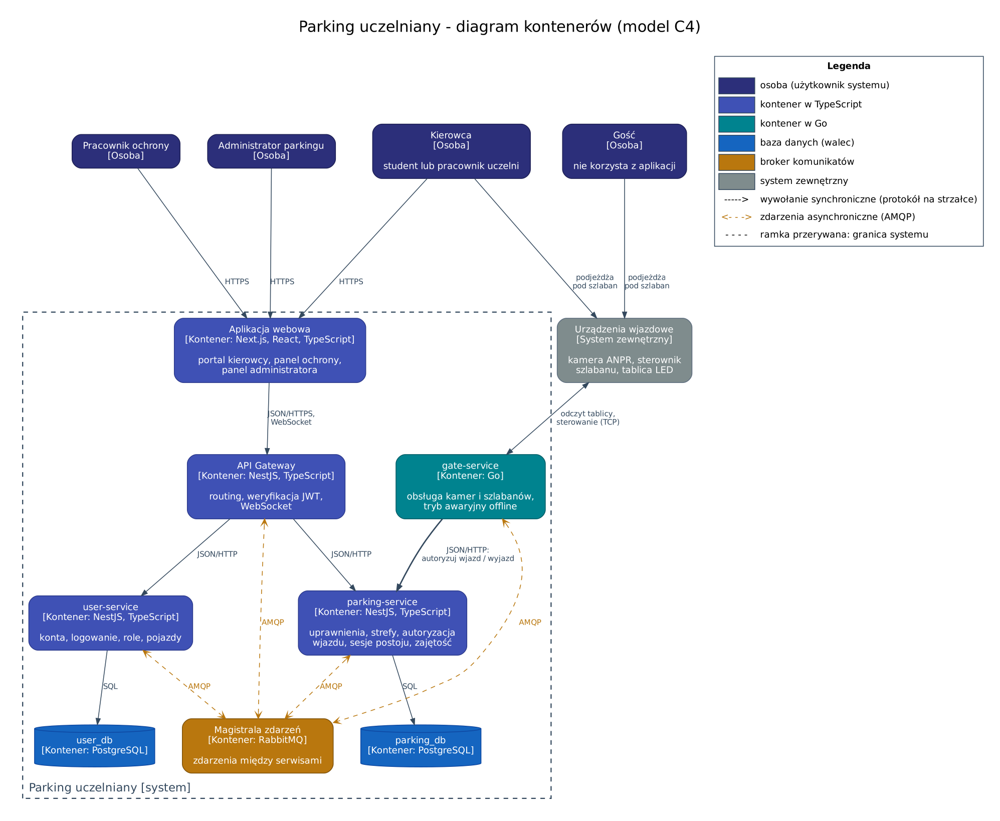

# Architektura systemu

**Styl:** mikroserwisy komunikujące się przez REST (synchronicznie) i zdarzenia (asynchronicznie)
**Notacja:** model C4, poziom 2 - diagram kontenerów
**Pliki:** źródło [architektura/diagram-kontenerow.drawio](architektura/diagram-kontenerow.drawio), obraz [architektura/diagram-kontenerow.png](architektura/diagram-kontenerow.png)



Legenda znajduje się na diagramie. Każdy prostokąt to kontener, czyli osobno uruchamiana część systemu, z technologią w nawiasie kwadratowym. Ramka przerywana to granica systemu, szary prostokąt to system zewnętrzny, a na strzałkach podano protokół.

## 1. Kontenery

| Kontener | Technologia | Odpowiedzialność | Dane |
|----------|-------------|------------------|------|
| **Aplikacja webowa** | Next.js, React, TypeScript | Portal kierowcy, panel ochrony, panel administratora (jedna aplikacja, widoki zależne od roli) oraz aplikacja bramowa: widok na telefon z trybami wjazd i wyjazd, ręczne wpisanie numeru rejestracyjnego i wyświetlenie decyzji | - |
| **API Gateway** | TypeScript (NestJS) | Jedyny punkt wejścia dla aplikacji webowej: routing do serwisów, weryfikacja tokenu JWT, kanał WebSocket dla danych na żywo | - |
| **user-service** | TypeScript (NestJS) | Konta, logowanie (e-mail i hasło), wydawanie tokenów JWT, role, pojazdy | PostgreSQL `user_db` |
| **parking-service** | TypeScript (NestJS) | Uprawnienia i przepustki, strefy, autoryzacja wjazdu i wyjazdu, sesje postoju, zajętość | PostgreSQL `parking_db` |
| **gate-service** | Go | Warstwa urządzeń wjazdowych: przyjmuje odczyt tablicy z aplikacji bramowej (docelowo z kamer ANPR, steruje szlabanami i tablicami LED); tryb awaryjny offline | lokalna kopia listy uprawnień |
| **Magistrala zdarzeń** | RabbitMQ | Przekazywanie zdarzeń między serwisami | - |

## 2. Zasady architektoniczne

1. **Baza danych per serwis.** Żaden serwis nie czyta bezpośrednio z bazy innego serwisu. Dane wymieniane są przez API albo zdarzenia.
2. **Jeden punkt wejścia.** Aplikacja webowa rozmawia wyłącznie z API Gateway. Serwisy nie są wystawione na zewnątrz.
3. **Ścieżka krytyczna jest krótka.** Wjazd wymaga tylko dwóch serwisów: `gate-service` i `parking-service`. Uprawnienia i licznik miejsc należą do `parking-service`, więc awaria `user-service` nie zatrzymuje szlabanów (NFR-05).
4. **Zdarzenia jako punkt rozszerzeń.** Serwisy publikują zdarzenia o tym, co się stało. Nowy serwis podłącza się jako kolejny odbiorca, bez zmian w istniejącym kodzie (NFR-12).
5. **Serwisy bezstanowe.** Stan trzymany jest w bazach, więc każdy serwis można uruchomić w kilku instancjach (NFR-11).
6. **Tryb awaryjny na bramie.** `gate-service` przechowuje lokalną kopię listy uprawnionych tablic i przy braku łączności z platformą podejmuje decyzję samodzielnie, a zdarzenia synchronizuje później (NFR-04).
7. **Urządzenia wjazdowe są wymienialne.** Aplikacja bramowa na telefonie i docelowa kamera ANPR ze szlabanem i tablicą LED są adapterami w `gate-service` o tym samym kontrakcie. Podłączenie prawdziwych urządzeń nie wymaga zmian w `parking-service` ani w pozostałych serwisach.

## 3. Najważniejsze zdarzenia

| Zdarzenie | Publikuje | Odbierają | Skutek |
|-----------|-----------|-----------|--------|
| `vehicle.registered` | user-service | parking-service | Pojazd trafia na listę oczekujących na uprawnienie |
| `vehicle.removed` | user-service | parking-service | Wygaszenie uprawnień usuniętego pojazdu |
| `permit.granted` / `permit.revoked` | parking-service | gate-service | Aktualizacja lokalnej kopii uprawnień |
| `guest-pass.issued` / `cancelled` | parking-service | gate-service | Aktualizacja lokalnej kopii uprawnień |
| `vehicle.entered` / `vehicle.exited` | parking-service | gate-service, API Gateway | Aktualizacja tablicy LED i widoków na żywo |
| `gate.entry.needs-attention` | gate-service | API Gateway | Zgłoszenie w panelu ochrony |

## 4. Przepływ: automatyczny wjazd (UC-06)

1. Aplikacja bramowa (tryb "wjazd") przekazuje wpisaną tablicę przez API Gateway do `gate-service`.
2. `gate-service` wywołuje synchronicznie `parking-service`: "autoryzuj wjazd" (tablica, identyfikator bramy).
3. `parking-service` sprawdza uprawnienie i w jednej transakcji zmniejsza licznik wolnych miejsc strefy, o ile jest większy od zera.
4. `parking-service` zwraca decyzję. Przy zgodzie tworzy sesję postoju i publikuje `vehicle.entered`.
5. `gate-service` zwraca decyzję aplikacji bramowej, która ją wyświetla.
6. Przy odmowie z powodu braku uprawnienia `gate-service` publikuje `gate.entry.needs-attention`, a API Gateway przekazuje zgłoszenie przez WebSocket do panelu ochrony.

## 5. Przepływ: od rejestracji pojazdu do uprawnienia (UC-03, UC-04)

1. Kierowca rejestruje pojazd; żądanie trafia przez API Gateway do `user-service`, który zapisuje pojazd i publikuje `vehicle.registered`.
2. `parking-service` odbiera zdarzenie i dodaje pojazd do listy oczekujących na uprawnienie.
3. Administrator nadaje uprawnienie w `parking-service` (przez API Gateway).
4. `parking-service` zapisuje uprawnienie i publikuje `permit.granted`; `gate-service` aktualizuje lokalną kopię.

## 6. Punkty rozszerzeń

Funkcje odłożone (US-15 do US-18) dodaje się bez przebudowy istniejących serwisów:

| Funkcja | Jak ją dodać | Co się zmienia w istniejącym kodzie |
|---------|--------------|-------------------------------------|
| Logowanie kontem uczelnianym (SSO) | Nowa strategia logowania OIDC w module `auth` w `user-service`, obok obecnej strategii e-mail i hasło | Nic poza `user-service`; reszta systemu nadal widzi tylko token JWT |
| Wnioski o abonament | Uprawnienie ma od początku pole `status`; dochodzą statusy "oczekuje" i "odrzucony" oraz moduł `applications` w `parking-service` | Formularz w aplikacji webowej |
| Płatności online | Nowy kontener `payment-service` z własną bazą, publikujący zdarzenie `payment.completed` | `parking-service` zaczyna odbierać to zdarzenie i aktywuje uprawnienie |
| Powiadomienia e-mail | Nowy kontener `notification-service` odbierający zdarzenia `permit.granted`, `permit.revoked` | Nic |
| Kamera ANPR, szlaban, tablica LED | Nowe adaptery w `internal/devices` w `gate-service`, obok adaptera aplikacji bramowej | Nic poza `gate-service` |
| Odczyt tablicy aparatem telefonu (US-20) | Rozszerzenie widoku bramowego w aplikacji webowej; odczyt trafia tym samym kontraktem co wpisany numer | Tylko aplikacja webowa |
| Większy ruch | Redis jako licznik miejsc i cache uprawnień | Tylko `parking-service` |

## 7. Struktura kodu w repozytorium

Monorepo: wszystkie serwisy w jednym repozytorium, kod w katalogu `src/`.

```
repo/
├── README.md
├── package.json                 # wspólne skrypty
├── pnpm-workspace.yaml          # src/apps/*, src/services/*, src/packages/*
├── turbo.json
├── docker-compose.yml           # serwisy + PostgreSQL + RabbitMQ
├── docs/
└── src/
    ├── apps/
    │   └── web/                 # aplikacja webowa, w tym widok bramowy
    ├── services/
    │   ├── api-gateway/
    │   ├── user-service/
    │   ├── parking-service/
    │   └── gate-service/        
    └── packages/
        ├── contracts/           # typy zdarzeń, schematy Zod
        └── config/              # wspólny tsconfig i eslint
```

Każdy serwis NestJS ma ten sam układ (przykład: `user-service`):

```
user-service/
├── Dockerfile
├── package.json
├── prisma/
│   ├── schema.prisma
│   └── migrations/
├── src/
│   ├── main.ts
│   ├── app.module.ts
│   ├── config/                  # zmienne środowiskowe z walidacją
│   ├── modules/
│   │   ├── auth/                # logowanie, JWT, strategies/local.strategy.ts
│   │   ├── users/
│   │   └── vehicles/
│   ├── events/
│   │   ├── publishers/
│   │   └── consumers/
│   └── common/                  # guardy, filtry, dekoratory
└── test/
```

Moduły `parking-service`: `permits/`, `zones/`, `access/` (autoryzacja wjazdu), `sessions/`, `occupancy/`. `api-gateway` nie ma katalogu `prisma/`, ma moduły `proxy/` i `realtime/`.

Serwis w Go:

```
gate-service/
├── Dockerfile
├── go.mod
├── cmd/
│   └── gate/
│       └── main.go
└── internal/
    ├── config/
    ├── devices/                 # adapter aplikacji bramowej
    ├── parkingclient/           # klient REST do parking-service
    ├── events/                  # publikacja i odbiór z RabbitMQ
    └── offline/                 # lokalna kopia uprawnień
```

## 8. Wdrożenie

Każdy kontener z diagramu działa jako osobny kontener Docker. Środowisko deweloperskie i demonstracyjne uruchamiane jest przez Docker Compose. Urządzenia wjazdowe są w projekcie zastąpione aplikacją bramową uruchamianą w przeglądarce telefonu, więc wszystkie scenariusze wjazdu i wyjazdu można odegrać bez fizycznego sprzętu. `gate-service` jest zaprojektowany tak, aby docelowo mógł działać na komputerze przy szlabanie.
