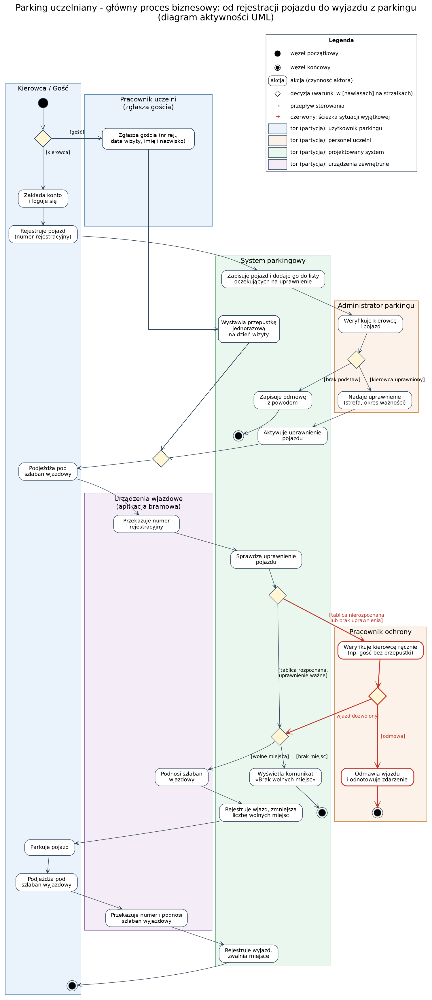

# Model głównego procesu biznesowego

**Proces:** od rejestracji pojazdu do wyjazdu z parkingu
**Technika:** diagram aktywności UML z partycjami (torami) dla aktorów
**Pliki:** źródło [model-procesu.drawio](model-procesu.drawio), obraz [model-procesu.png](model-procesu.png)

## 1. Legenda

Legenda znajduje się również na samym diagramie.

| Symbol | Znaczenie |
|--------|-----------|
| Czarne koło | Węzeł początkowy |
| Czarne koło w obwódce | Węzeł końcowy |
| Prostokąt z zaokrąglonymi rogami | Akcja (czynność wykonywana przez aktora z danego toru) |
| Romb | Decyzja - warunki (wartownicy) w [nawiasach] na strzałkach wychodzących; romb z kilkoma strzałkami wchodzącymi to scalenie ścieżek |
| Strzałka z otwartym grotem | Przepływ sterowania |
| Kolor czerwony | Ścieżka sytuacji wyjątkowej |
| Tor (partycja) niebieski | Użytkownik parkingu (kierowca, gość, pracownik uczelni zgłaszający gościa) |
| Tor (partycja) pomarańczowy | Personel uczelni (administrator, ochrona) |
| Tor (partycja) zielony | Projektowany system |
| Tor (partycja) fioletowy | Urządzenia zewnętrzne |

## 2. Opis przebiegu

Na początku procesu decyzja rozdziela ścieżki: `[kierowca]` przechodzi przez etap 1, `[gość]` przez ścieżkę gościa. Obie ścieżki łączą się przed wjazdem (etap 2).

**Etap 1 - uzyskanie uprawnienia (kierowca)**

1. Kierowca zakłada konto i loguje się.
2. Kierowca rejestruje pojazd, podając numer rejestracyjny.
3. System zapisuje pojazd i dodaje go do listy oczekujących na uprawnienie.
4. Administrator weryfikuje kierowcę i pojazd.
5. Jeśli kierowca ma prawo parkować, administrator nadaje uprawnienie (strefa, okres ważności), a system je aktywuje. W przeciwnym razie system zapisuje odmowę z powodem i proces się kończy.

**Ścieżka gościa - przepustka jednorazowa**

- Pracownik uczelni zgłasza gościa, podając numer rejestracyjny, datę wizyty oraz imię i nazwisko gościa.
- System wystawia przepustkę jednorazową ważną w dniu wizyty.

**Etap 2 - wjazd**

6. Kierowca podjeżdża pod szlaban, urządzenie wjazdowe przekazuje numer rejestracyjny (aplikacja bramowa w trybie "wjazd": numer wpisany ręcznie; docelowo odczyt z kamery ANPR).
7. System sprawdza, czy pojazd ma ważne uprawnienie lub przepustkę jednorazową.
8. System sprawdza, czy w strefie są wolne miejsca.
9. Szlaban się podnosi, system rejestruje wjazd i zmniejsza liczbę wolnych miejsc.

**Etap 3 - postój i wyjazd**

10. Kierowca parkuje, a po zakończeniu postoju podjeżdża pod szlaban wyjazdowy.
11. Urządzenie wjazdowe przekazuje numer (aplikacja bramowa w trybie "wyjazd"), szlaban się podnosi, system rejestruje wyjazd i zwalnia miejsce.

## 3. Decyzje

| Decyzja | Tor | Warunek i dalszy przebieg | Warunek i dalszy przebieg |
|---------|-----|---------------------------|---------------------------|
| Rodzaj użytkownika | Kierowca | `[kierowca]` - założenie konta i rejestracja pojazdu (etap 1) | `[gość]` - zgłoszenie gościa przez pracownika uczelni i przepustka jednorazowa |
| Wynik weryfikacji kierowcy | Administrator | `[kierowca uprawniony]` - nadanie uprawnienia | `[brak podstaw]` - zapis odmowy, proces się kończy |
| Weryfikacja pojazdu przy wjeździe | System parkingowy | `[tablica rozpoznana, uprawnienie ważne]` - sprawdzenie wolnych miejsc | `[tablica nierozpoznana lub brak uprawnienia]` - **sytuacja wyjątkowa**, sprawę przejmuje ochrona |
| Decyzja ochrony | Pracownik ochrony | `[wjazd dozwolony]` - powrót do głównej ścieżki | `[odmowa]` - proces się kończy |
| Dostępność miejsc | System parkingowy | `[wolne miejsca]` - szlaban się podnosi | `[brak miejsc]` - komunikat "Brak wolnych miejsc", proces się kończy |

## 4. Sytuacja wyjątkowa

**Nierozpoznana tablica lub brak ważnego uprawnienia** (na diagramie kolor czerwony). Przyczyną może być błędnie wpisany numer lub zabrudzona tablica i błąd kamery, wygasłe uprawnienie albo gość bez przepustki. Automatyczna ścieżka zostaje przerwana, a pracownik ochrony weryfikuje kierowcę ręcznie (np. sprawdza legitymację lub listę gości). Jeśli uzna wjazd za dozwolony, proces wraca do głównej ścieżki, a zdarzenie jest zapisywane jako wjazd ręczny. W przeciwnym razie ochrona odmawia wjazdu i odnotowuje zdarzenie.

## 5. Udział aktorów

| Aktor | Udział w procesie |
|-------|-------------------|
| Kierowca | Konto, rejestracja pojazdu, wjazd, postój, wyjazd |
| Gość | Etapy 2 i 3 na podstawie przepustki jednorazowej (bez etapu 1); wspólny tor "Kierowca / Gość" |
| Pracownik uczelni | Zgłoszenie gościa (ścieżka gościa) |
| Pracownik ochrony | Obsługa sytuacji wyjątkowej przy wjeździe |
| Administrator parkingu | Weryfikacja kierowcy i nadanie uprawnienia |
| Urządzenia wjazdowe | Przekazanie numeru rejestracyjnego, podniesienie szlabanu (aplikacja bramowa na telefonie) |
