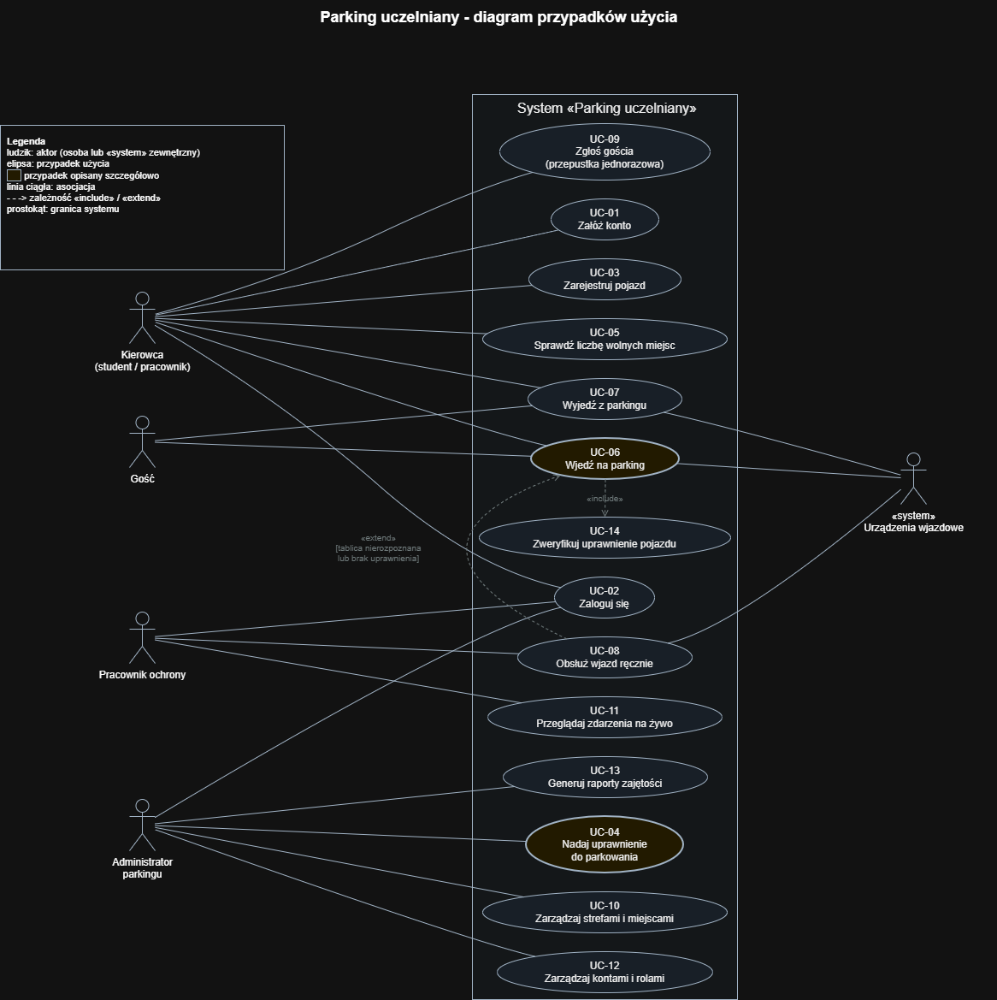

# Przypadki użycia

## 1. Diagram przypadków użycia

**Pliki:** źródło [przypadki-uzycia/diagram-przypadkow-uzycia.drawio](przypadki-uzycia/diagram-przypadkow-uzycia.drawio), obraz [przypadki-uzycia/diagram-przypadkow-uzycia.png](przypadki-uzycia/diagram-przypadkow-uzycia.png)

Elementy diagramu: aktor to rola spoza systemu (osoba lub system zewnętrzny), elipsa to przypadek użycia nazwany czasownikiem, prostokąt to granica systemu. «include» oznacza część wykonywaną zawsze, «extend» rozszerzenie opcjonalne, wykonywane pod warunkiem podanym w nawiasie.

Uwagi do diagramu:

- Przypadki dostępne w aplikacji webowej (UC-03 do UC-05 i UC-08 do UC-13) wymagają wcześniejszego zalogowania (UC-02). Dla czytelności nie rysowano tych zależności.
- UC-09 jest dostępny tylko dla kierowcy z rolą pracownika uczelni.
- Na żółto oznaczono przypadki opisane szczegółowo poniżej.

## 2. Lista przypadków użycia

| ID | Przypadek użycia | Aktorzy | Powiązane user stories |
|----|------------------|---------|------------------------|
| UC-01 | Załóż konto | Kierowca | US-01 |
| UC-02 | Zaloguj się | Kierowca, pracownik ochrony, administrator | US-02 |
| UC-03 | Zarejestruj pojazd | Kierowca | US-03 |
| UC-04 | Nadaj uprawnienie do parkowania | Administrator | US-04 |
| UC-05 | Sprawdź liczbę wolnych miejsc | Kierowca | US-08 |
| UC-06 | Wjedź na parking | Kierowca, gość, urządzenia wjazdowe | US-05 |
| UC-07 | Wyjedź z parkingu | Kierowca, gość, urządzenia wjazdowe | US-06 |
| UC-08 | Obsłuż wjazd ręcznie | Pracownik ochrony, urządzenia wjazdowe | US-07 |
| UC-09 | Zgłoś gościa (przepustka jednorazowa) | Kierowca (pracownik) | US-10 |
| UC-10 | Zarządzaj strefami i miejscami | Administrator | US-09 |
| UC-11 | Przeglądaj zdarzenia na żywo | Pracownik ochrony | US-11 |
| UC-12 | Zarządzaj kontami i rolami | Administrator | US-12 |
| UC-13 | Generuj raporty zajętości | Administrator | US-14 |
| UC-14 | Zweryfikuj uprawnienie pojazdu | (włączany przez UC-06) | US-05 |

## 3. Opis przypadku UC-06: Wjedź na parking

| Pole | Opis |
|------|------|
| **Cel** | Pojazd z ważnym uprawnieniem wjeżdża na parking bez udziału ochrony |
| **Aktor główny** | Kierowca lub gość |
| **Aktorzy wspierający** | Urządzenia wjazdowe (aplikacja bramowa na telefonie) |
| **Wyzwalacz** | Pojazd podjeżdża pod szlaban wjazdowy |
| **Warunki wstępne** | Urządzenia wjazdowe działają i mają połączenie z systemem |
| **Warunki końcowe (sukces)** | Szlaban został podniesiony; istnieje otwarta sesja postoju pojazdu; liczba wolnych miejsc w strefie zmniejszyła się o 1 |
| **Warunki końcowe (niepowodzenie)** | Szlaban pozostał zamknięty; zdarzenie zostało zapisane; liczba wolnych miejsc się nie zmieniła |

**Scenariusz główny**

1. Kierowca podjeżdża pod szlaban wjazdowy.
2. Urządzenie wjazdowe przekazuje numer rejestracyjny do systemu.
3. System weryfikuje uprawnienie pojazdu: aktywne uprawnienie lub przepustka jednorazowa na bieżący dzień (UC-14).
4. System sprawdza, czy w strefie przypisanej do uprawnienia są wolne miejsca.
5. System wysyła polecenie podniesienia szlabanu.
6. System zapisuje sesję postoju (pojazd, strefa, czas wjazdu) i zmniejsza liczbę wolnych miejsc o 1.
7. Urządzenie wjazdowe pokazuje decyzję i zaktualizowaną liczbę wolnych miejsc.
8. Kierowca wjeżdża, szlaban się zamyka.

**Scenariusze alternatywne**

- **4a. Brak wolnych miejsc w strefie**
  1. System nie podnosi szlabanu.
  2. Urządzenie wjazdowe wyświetla "Brak wolnych miejsc".
  3. System zapisuje zdarzenie odmowy z przyczyną "brak miejsc". Przypadek kończy się niepowodzeniem.
- **3a. Pojazd ma już otwartą sesję postoju** (np. poprzedni wyjazd nie został odnotowany)
  1. System zamyka starą sesję z oznaczeniem "do wyjaśnienia".
  2. Scenariusz wraca do kroku 4.

**Sytuacje wyjątkowe**

- **2a. Tablica nie została rozpoznana** (w aplikacji bramowej: numer ma niepoprawny format) albo **3b. Pojazd nie ma ważnego uprawnienia**
  1. System nie podnosi szlabanu i wysyła zgłoszenie do panelu ochrony.
  2. Uruchamiany jest przypadek UC-08 "Obsłuż wjazd ręcznie" (rozszerzenie).
  3. Jeśli ochrona wybierze "Wpuść", scenariusz wraca do kroku 4, a sesja jest oznaczana jako wjazd ręczny. Jeśli wybierze "Odmów", przypadek kończy się niepowodzeniem.
- **5a. Szlaban nie potwierdził podniesienia w ciągu 5 s**
  1. System ponawia polecenie jeden raz.
  2. Jeśli szlaban nadal nie odpowiada, system zgłasza awarię do panelu ochrony i nie zapisuje sesji postoju.
- **2b. Brak połączenia serwisu bramowego z platformą**
  1. Serwis bramowy przechodzi w tryb awaryjny i weryfikuje pojazd na podstawie lokalnej kopii listy uprawnień.
  2. Zdarzenia są zapisywane lokalnie i synchronizowane po odzyskaniu połączenia.

**Wymagania powiązane:** US-05, US-07, US-19, NFR-01, NFR-04, NFR-05.

## 4. Opis przypadku UC-04: Nadaj uprawnienie do parkowania

| Pole | Opis |
|------|------|
| **Cel** | Zarejestrowany pojazd otrzymuje prawo do parkowania w wybranej strefie |
| **Aktor główny** | Administrator parkingu |
| **Aktorzy wspierający** | Brak |
| **Wyzwalacz** | Administrator otwiera listę pojazdów oczekujących na uprawnienie |
| **Warunki wstępne** | Administrator jest zalogowany (UC-02); kierowca zarejestrował pojazd (UC-03) |
| **Warunki końcowe (sukces)** | Pojazd ma aktywne uprawnienie w strefie z datą końca ważności; pojazd jest wpuszczany automatycznie |
| **Warunki końcowe (niepowodzenie)** | Pojazd nie ma uprawnienia; kierowca widzi status i powód odmowy |

**Scenariusz główny**

1. Administrator otwiera listę pojazdów oczekujących na uprawnienie.
2. System wyświetla pojazdy z danymi kierowcy (imię, nazwisko, e-mail, rola).
3. Administrator wybiera pojazd i sprawdza, czy kierowca ma prawo parkować na terenie uczelni.
4. Administrator wybiera strefę i datę końca ważności.
5. Administrator zatwierdza nadanie uprawnienia.
6. System sprawdza, czy limit uprawnień w strefie nie został wyczerpany.
7. System zapisuje uprawnienie jako aktywne razem z identyfikatorem administratora i datą.
8. System przekazuje uprawnienie do serwisu bramowego (lokalna kopia na wypadek pracy offline).
9. Kierowca widzi przy pojeździe status "uprawnienie aktywne" ze strefą i datą ważności.

**Scenariusze alternatywne**

- **3a. Kierowca nie ma podstaw do parkowania**
  1. Administrator wybiera "Odmów" i wpisuje powód.
  2. System zapisuje odmowę; pojazd znika z listy oczekujących.
  3. Kierowca widzi przy pojeździe status "odmowa" z powodem. Przypadek kończy się niepowodzeniem.
- **6a. Limit uprawnień w strefie jest wyczerpany**
  1. System wyświetla komunikat o braku wolnych uprawnień w strefie.
  2. Administrator może wybrać inną strefę (powrót do kroku 4) albo zrezygnować.
- **1a. Administrator cofa istniejące uprawnienie**
  1. Administrator wyszukuje pojazd po numerze rejestracyjnym i wybiera "Cofnij uprawnienie".
  2. System oznacza uprawnienie jako cofnięte i przekazuje zmianę do serwisu bramowego.

**Sytuacje wyjątkowe**

- **7a. Błąd zapisu uprawnienia** (np. niedostępna baza danych)
  1. System wyświetla komunikat o błędzie i prosi o ponowienie później.
  2. Pojazd pozostaje na liście oczekujących.
- **8a. Serwis bramowy jest niedostępny**
  1. Uprawnienie pozostaje aktywne w systemie; pojazd jest wpuszczany, bo przy wjeździe decyzję podejmuje system.
  2. Lokalna kopia w serwisie bramowym jest uzupełniana po odzyskaniu połączenia.

**Wymagania powiązane:** US-03, US-04, NFR-08, NFR-09.
